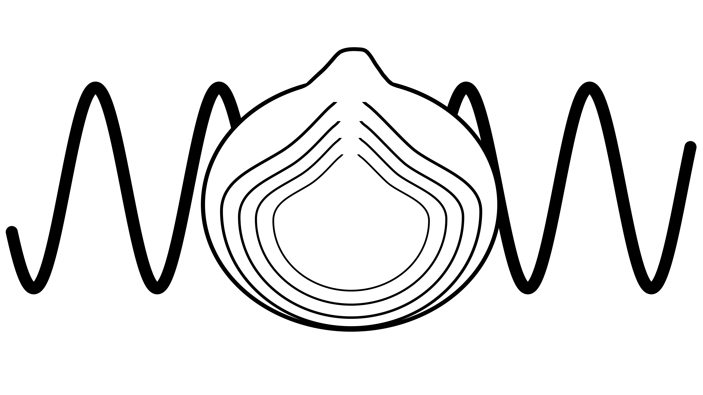

# OnionCAudio (Onion Custom Audio)
A layered audio format designed for game development.

**Features:**
- Perceptually lossless compression
- Near zero decoding load
- Multi-track stems
- Defined looping markers

## Format (v0.2, work in progress)
- Header: 64 bytes, little-endian
- Codec: [QOA](https://github.com/phoboslab/qoa) (16-bit storage, stock big-endian payload)
- Output: 32-bit float, 48 kHz
- Stems: stereo, interleaved per slice (max 15 stems)
- Volume: file-wide multiplier, Q4.12 fixed point (see [docs](documentation.md))

## Roadmap
- 32-bit float 48 kHz output
- AVX2
- Cross-platform
- .ocaudio header
- QOA encoder / decoder
- Seek table for loop points
- Interleaved stream

## Usage
`./main <filename.ocaudio>`